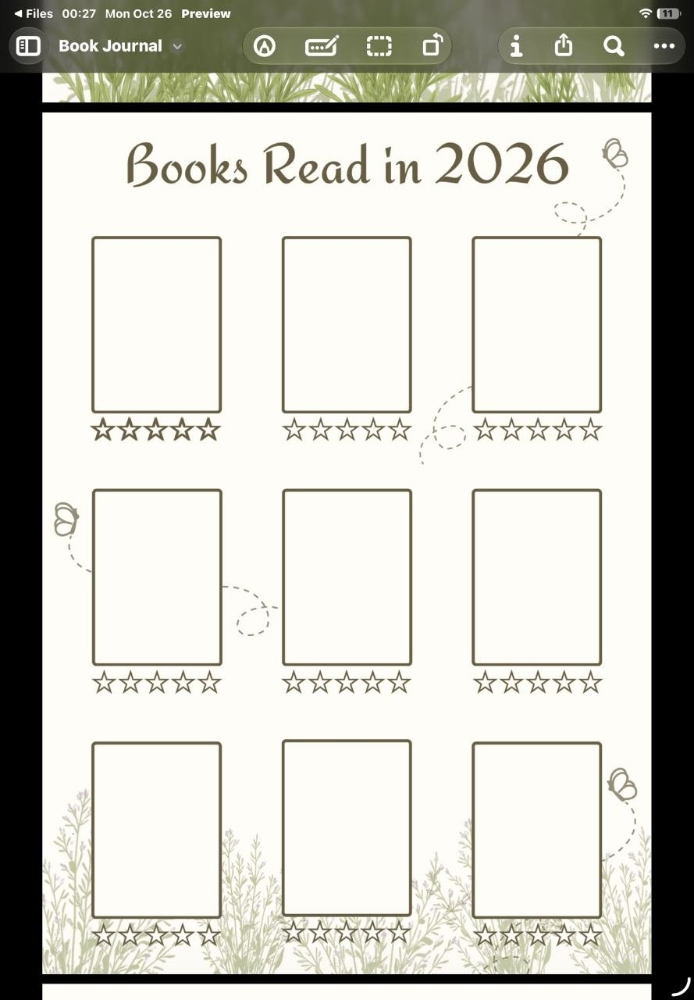
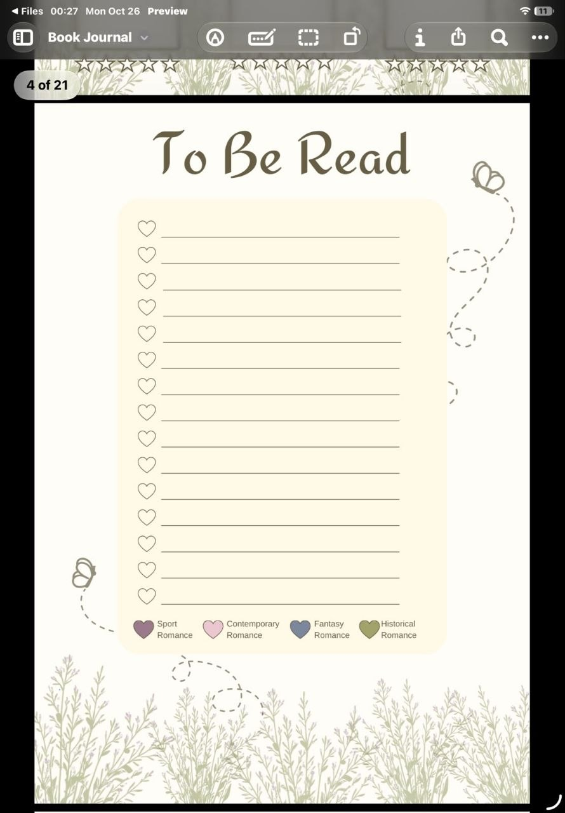
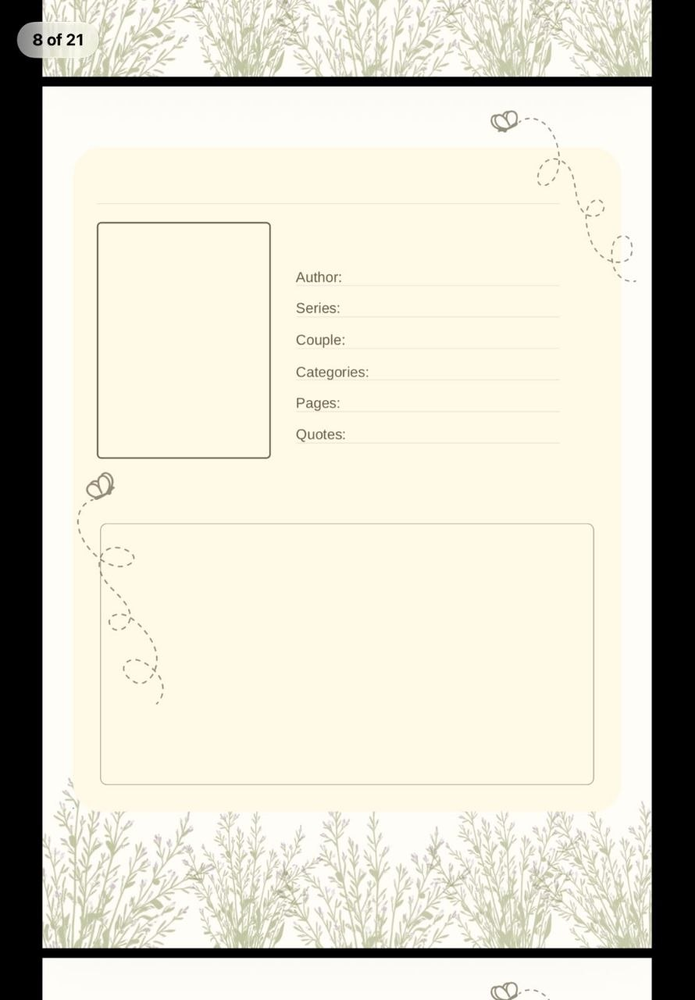
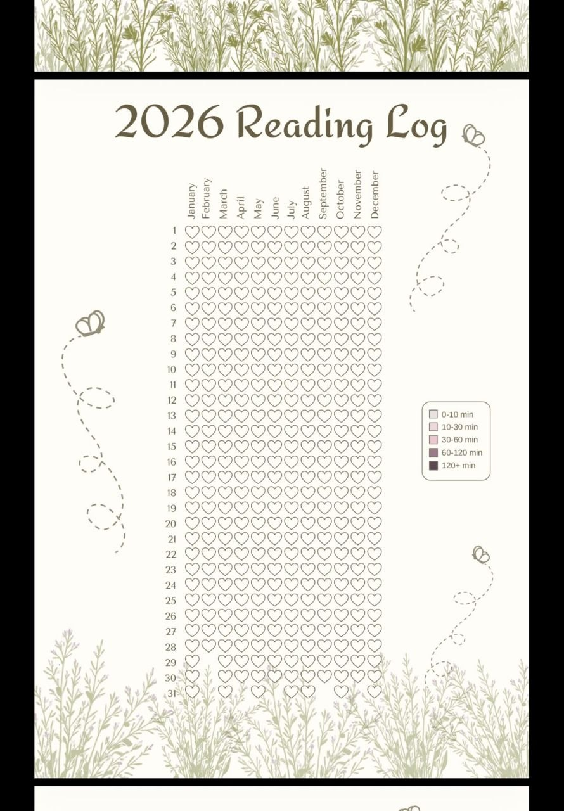

# Leafmark visual design references

The attached designer pages establish the visual language for the iPad-first app:

- Warm ivory page backgrounds with muted olive, taupe, and brown text and outlines.
- Elegant serif display headings, with clear sans-serif labels for book metadata.
- Fine botanical foliage along page edges, dotted butterfly trails, and light linework.
- Soft cream panels with rounded corners and generous space for writing.
- Covers displayed in a three-column grid with star ratings; a TBR list with heart markers and a restrained category palette.
- A book page with a cover, compact bibliographic fields, and a large area for personal notes.
- A year reading log arranged as months by day, with a legend for the reader's activity categories.

Treat the pictured 2026 pages as layout and style references; the year label and calendar dates must follow the selected year. The example activity thresholds, category names, and colors are editable data in the app, not fixed values from the artwork. The couple/character field is an optional Book page field.

## Page references

### Read books grid

### To Be Read list

### Book page

### Annual reading log

